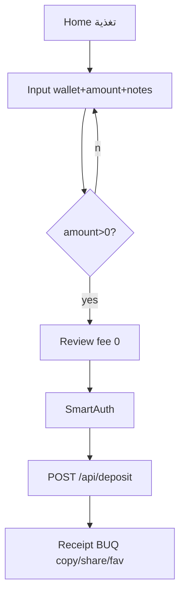
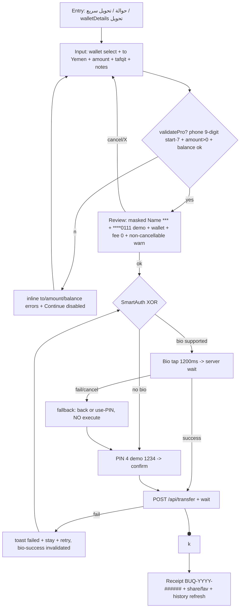
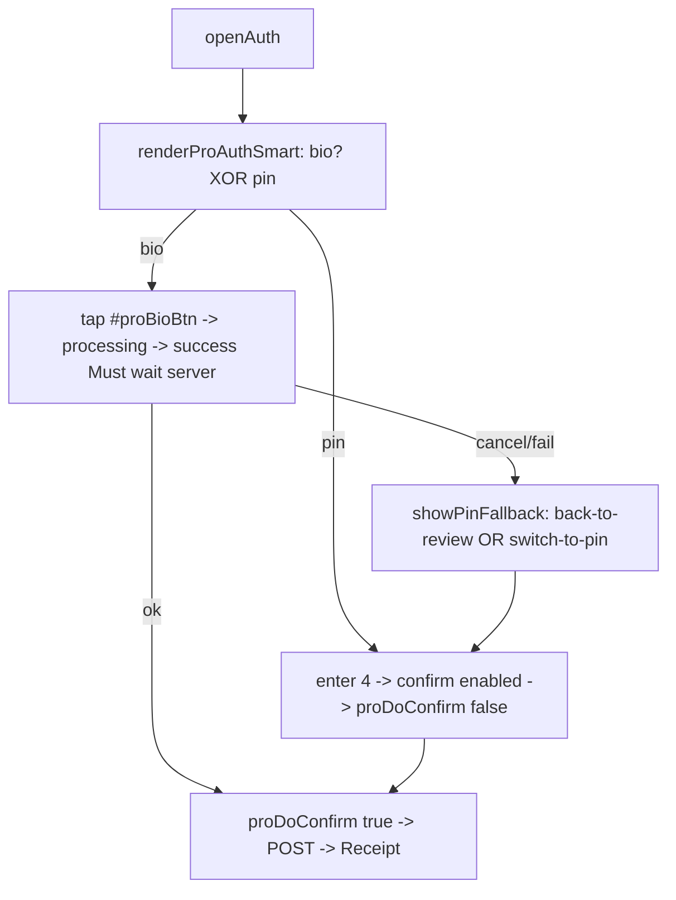
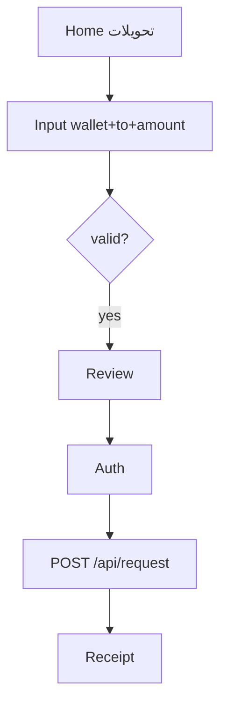
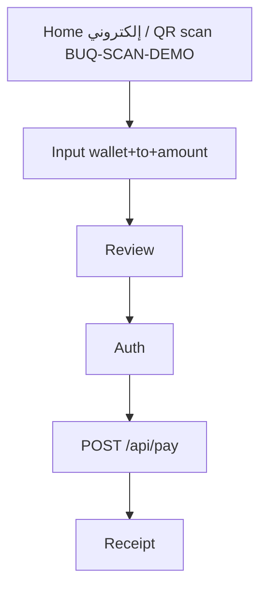
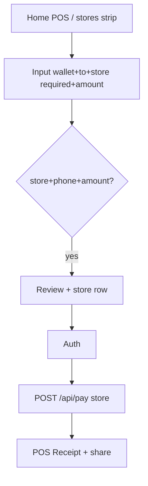
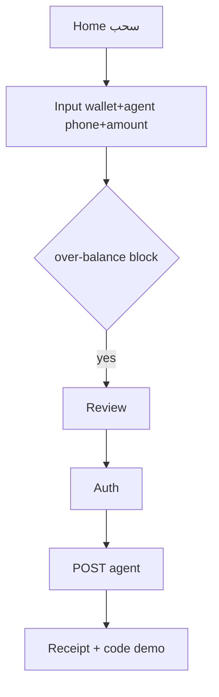
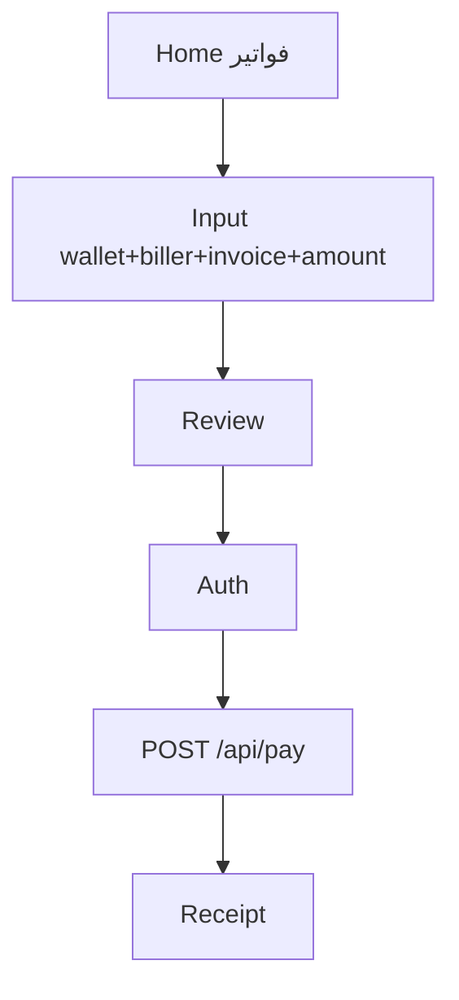
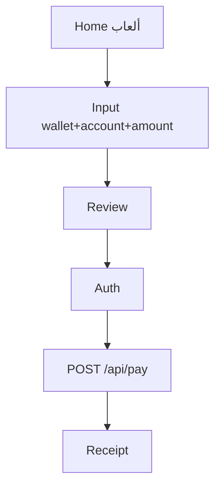

# 05 — Service Flow Maps (9 services + detailed Transfer + SmartAuth)
> Endpoints: `deposit→/api/deposit`, `transfer→/api/transfer`, `request→/api/request`, `pay_elec|pos|bills|games→/api/pay`, `withdraw→/api/transfer(agent demo)`, `exchange→/api/exchange`. Fee `0` server-only. Store field only for `pos`. Yemen phone rule except `exchange` (free text). Demo `777000111/1234`.
## Deposit — تغذية `/api/deposit`

## Transfer — حوالة `/api/transfer` (DETAILED 4-STAGE)

### SmartAuth decision

## Request — تحويلات `/api/request`

## Pay_elec — إلكتروني `/api/pay`

## POS — نقاط بيع `/api/pay + store`

## Withdraw — سحب `/api/transfer agent`

## Bills — فواتير `/api/pay`

## Games — ألعاب `/api/pay`

## Exchange — شبكي `/api/exchange`
```mermaid
graph TD
A[Home شبكي]-->B[Input wallet+free-text to+amount, no Yemen rule]
B-->C{amount>0?}
C--yes-->D[Review]
D-->E[Auth]
E-->F[POST /api/exchange]
F-->G[Receipt]