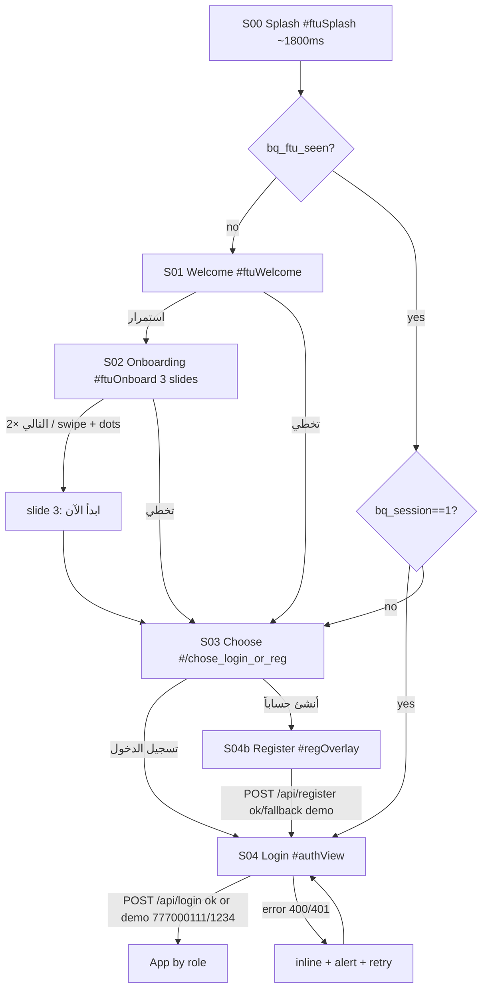
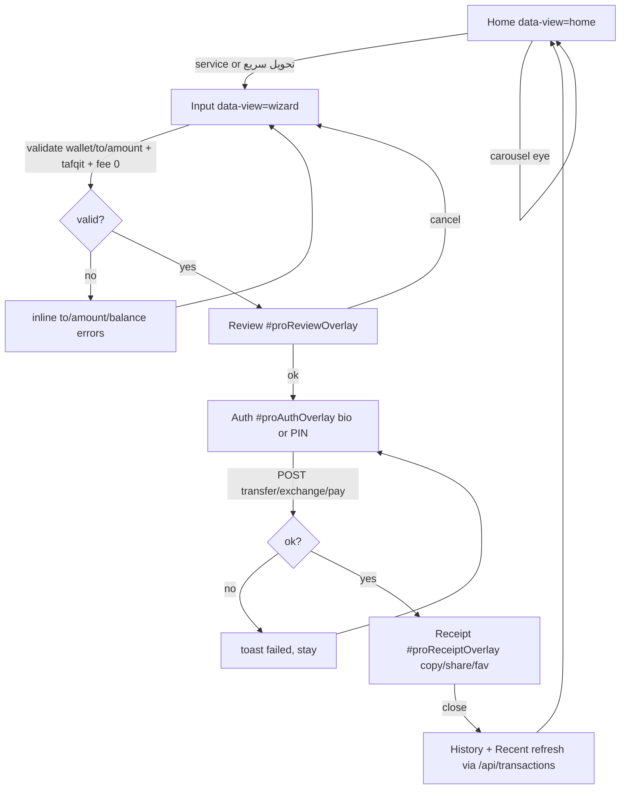
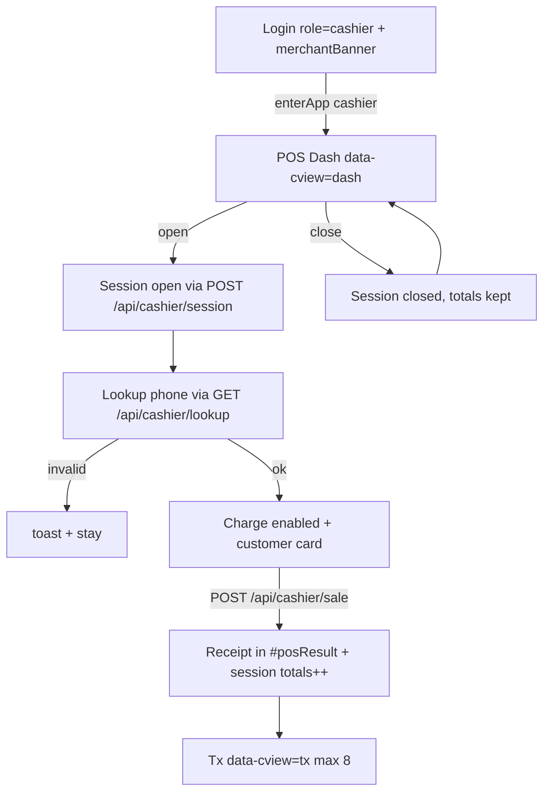

# 04 — User Flows (mermaid + steps, demo paths labeled)
## F1 — First-time FTU (Splash → Welcome → Onboarding → Choose → Login/Register)

Steps: 1) splash auto-hide (reduced-motion instant). 2) welcome scene + CTAs. 3) onboarding swipe/dots/prev-next/start. 4) choose fork + hash. 5) login role-pill + Yemen phone + 4-PIN + bio demo. 6) register sheet validation. Errors retry on same screen; `markSeen()` persists `bq_ftu_seen`.
## F2 — Customer money (Home → Wallets → Input → Review → Auth → Receipt → History)

Steps: select wallet (balance hint) → to (Yemen rule; exchange free-text; POS store field) → amount (tafqit words, over-balance block) → notes → fee `0 server only` → review masked name/phone → auth → receipt ref `BUQ-YYYY-######` → history. All demo `0-fee تجريبي`.
## F3 — Cashier sale (Login cashier → Session → Lookup → Sale → Receipt → Tx)

Steps: open session → enter amount+phone → lookup masked customer → charge → receipt + totals — totals/fees **NEEDS-BACKEND-REVIEW**. Drawer/lang/sheets available throughout; `cgoto()` falls back to `dash` (never blank).