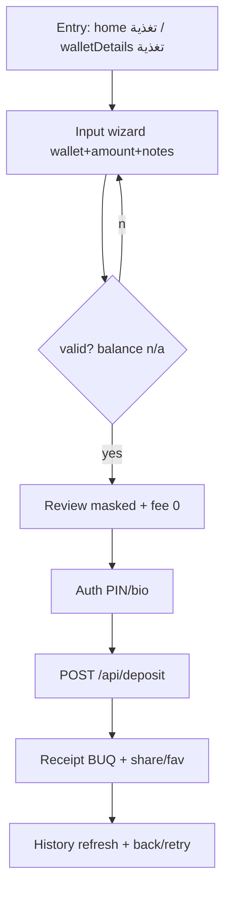
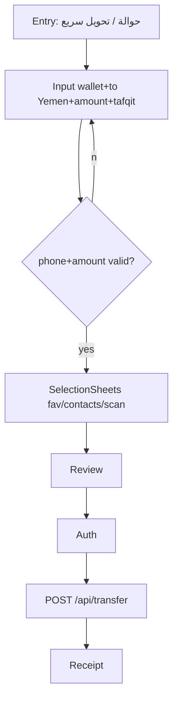
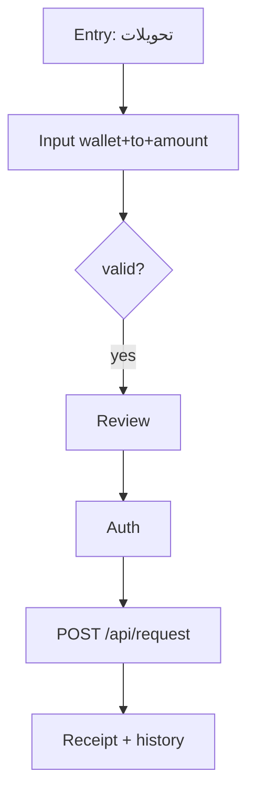
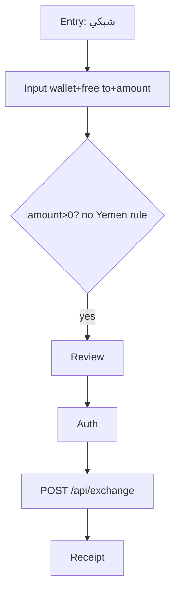
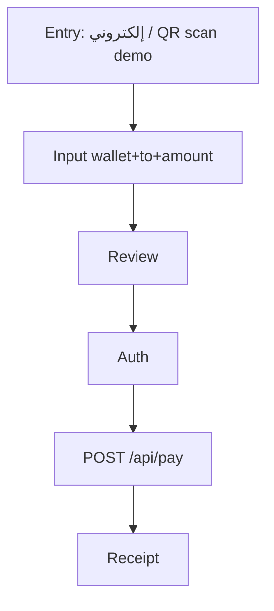
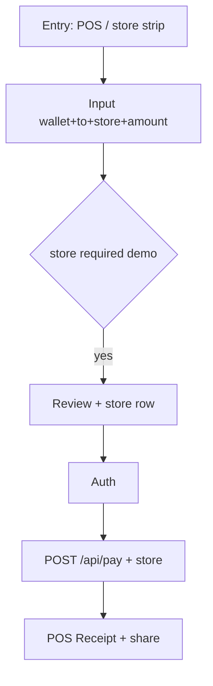
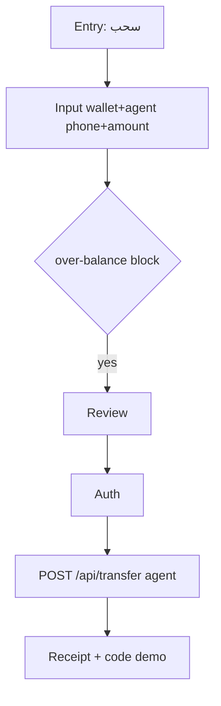
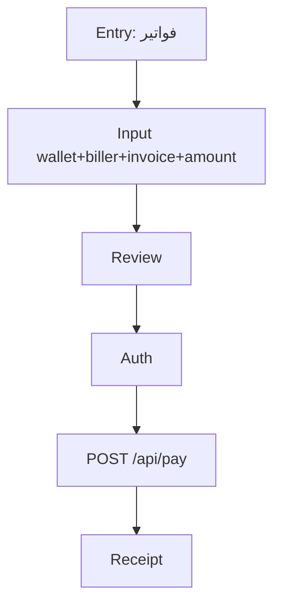
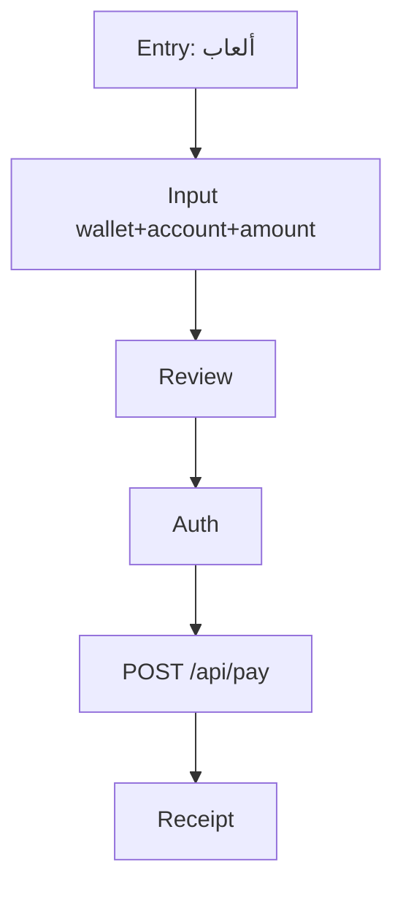

# Service Flow Maps — 9 Independent Flows (Input-Review-Auth-Receipt pattern)
> Fee 0 server-only. No invented pricing. Endpoints: /api/deposit|transfer|request|withdraw|exchange|pay.
## 1) تغذية Add-Money (deposit)

## 2) حوالة محلية Send (transfer)

## 3) تحويل بين محافظ Internal (request)

## 4) مصارفة Exchange

## 5) إلكتروني E-pay

## 6) نقاط بيع POS (customer)

## 7) سحب نقدي Cash-Out

## 8) فواتير Bills

## 9) ألعاب/شبكي Games

Common states: Processing spinner #proProcessing, Success green receipt, Failure red + Retry (stay on auth/input), Back closes overlay, Empty skeleton/dashed, Offline toast failed + retry.